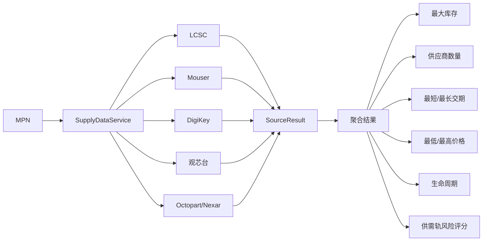
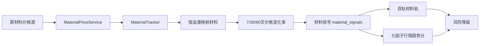
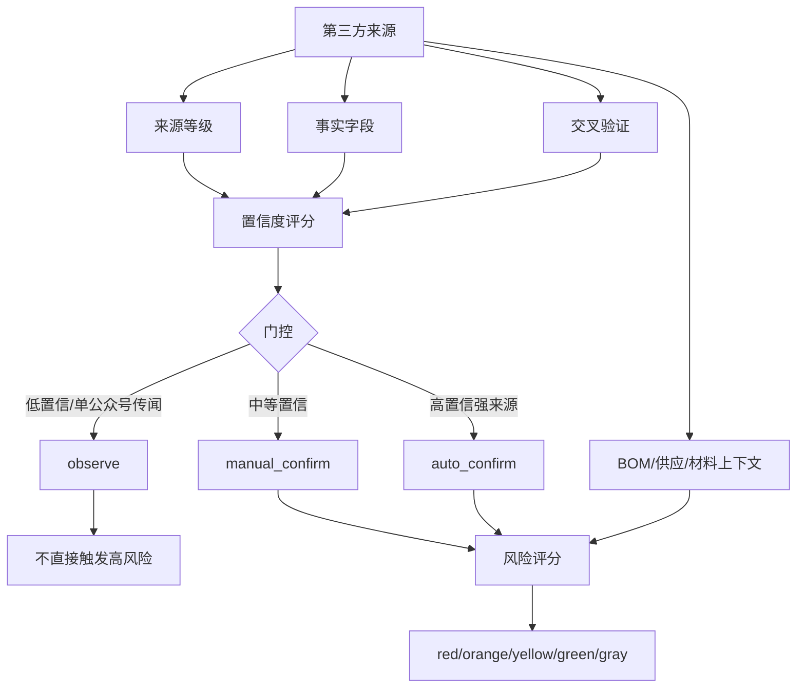

# 风险事件链路第三方信息源清单

> 适用范围：`交期风险排查V4`。本文汇总风险事件链路中已经在代码、知识库、模板或配置中出现的第三方信息源，不论来源是网站、API、公众号、行业报告、原厂公告、供应商通知还是人工转发。重点说明：来源用途、取数方式、当前实现状态、是否能直接触发高风险。

---

## 1. 信息源总览框图

```mermaid
flowchart TB
    A[风险事件链路第三方信息源] --> B[供应库存/交期/价格]
    A --> C[原材料价格]
    A --> D[灾害/区域风险]
    A --> E[行业媒体/公众号]
    A --> F[原厂/代理商/PCN]
    A --> G[行业报告/市场研究]
    A --> H[政策/合规]
    A --> I[国内现货/分销行情]

    B --> B1[LCSC/JLCSearch]
    B --> B2[Mouser]
    B --> B3[DigiKey]
    B --> B4[观芯台]
    B --> B5[Nexar/Octopart]
    B --> B6[芯查查]

    C --> C1[Metals API]
    C --> C2[SMM]
    C --> C3[Mysteel]
    C --> C4[LME]
    C --> C5[稀土/小金属/化工源]

    D --> D1[GDACS]
    D --> D2[USGS Earthquake]

    E --> E1[芯师爷]
    E --> E2[半导体行业观察]
    E --> E3[国际电子商情]
    E --> E4[满天芯]
    E --> E5[电子工程世界]
    E --> E6[芯智讯]

    F --> F1[原厂公告]
    F --> F2[官方 PCN/EOL]
    F --> F3[代理商通知]
    F --> F4[供应商邮件/涨价函]

    G --> G1[TrendForce]
    G --> G2[财报/业务更新]
    G --> G3[产业链调研]

    H --> H1[BIS]
    H --> H2[USTR]
    H --> H3[实体清单]
    H --> H4[关税]

    I --> I1[华强北现货报价]
    I --> I2[华强北指数]
    I --> I3[嘉立创/JLCPCB]
```



---

## 2. 当前代码中的媒体/公众号/行情源注册表

来源文件：`交期风险排查V4/backend/app/knowledge/media_sources.py`

| source_id | 名称 | 类型 | 接入方式 | crawler_strategy | enabled | 当前状态 | 风险链用途 | 备注 |
|---|---|---|---|---|---:|---|---|---|
| `xinshiyeye_wechat` | 芯师爷 | 微信公众号 | 公众号关注，人工转发/Feed 待接入 | `manual_forward` | 是 | 等待人工转发 | 行业行情、芯片/MLCC/MCU 专题 | 单源默认降权，进入观察或待复核 |
| `semiinsights_wechat` | 半导体行业观察 | 微信公众号 | 公众号关注，人工转发/Feed 待接入 | `manual_forward` | 是 | 等待人工转发 | 半导体产业趋势、产能、政策影响 | 适合提取趋势，不单独触发强预警 |
| `esmchina_web` | 国际电子商情 | 网站 + 公众号 | 官网 + 公众号 | `http_html` | 否 | 当前禁用 | 元器件行情、分销商动态 | 官网 JS 渲染不稳定，当前暂停自动采集 |
| `mantianxin_wechat` | 满天芯 | 微信公众号 | 公众号关注，人工转发/Feed 待接入 | `manual_forward` | 是 | 等待人工转发 | IC 交易行情、分销市场情绪 | 用于补充市场情绪 |
| `eeworld_web` | 电子工程世界 EEWorld | 网站 + 公众号 | 官网 + 公众号 | `http_html` | 否 | 当前禁用 | 行业资讯、技术趋势 | HTML 抓取不稳定，暂停自动采集 |
| `xinzhixun_wechat` | 芯智讯 | 微信公众号 | 公众号关注，人工转发/Feed 待接入 | `manual_forward` | 是 | 等待人工转发 | 芯片产业新闻 | 待接入公众号源 |
| `lcsc_jlcsearch` | 立创商城 / JLCSearch | 网站/API + 公众号 | JLCSearch API，公众号后续人工转发 | `api_json` | 是 | 启用 | 库存、热词趋势、器件可得性 | API 用于库存/热词，公众号用于活动补充 |
| `guanxintai_search` | 观芯台行情搜索 | 网站 | 网页关键词搜索 | `keyword_search` | 是 | 启用但可能降级 | 国内分销行情、价格库存搜索 | 已验证可作为关键词行情源之一 |

---

## 3. 供应库存/交期/价格数据源

来源目录：`交期风险排查V4/backend/app/services/sources/`

| 信息源 | 文件 | 类型 | 取数字段 | 取数方式 | 当前实现状态 | 是否需要密钥 | 风险判断用途 | 限制/降级 |
|---|---|---|---|---|---|---|---|---|
| LCSC / 立创商城 / JLCSearch | `lcsc.py` | JSON API | 库存、阶梯价格、厂牌、封装、LCSC 编号、数据手册链接 | `https://jlcsearch.tscircuit.com/api/search?q=...` | 已接入，默认可用 | 否 | 库存、价格、可得性、国产渠道补充 | 不支持真实交期和生命周期；有请求间隔 |
| Mouser | `mouser.py` | 授权分销商 API | 库存、价格、交期、生命周期等 | Mouser API | 代码已接入 | 是 | A级供应数据、交期和库存判断 | 无 Key 或健康检查失败时跳过 |
| DigiKey | `digikey.py` | 授权分销商 API | 库存、价格、交期、生命周期等 | DigiKey API | 代码已接入 | 是 | A级供应数据、生命周期和库存判断 | 依赖 client id / secret |
| 观芯台 | `guanxintai.py` | 网页搜索 | 型号、厂牌、封装、价格、库存、批次、交期、渠道 | HTML 表格解析 | 已接入但可能降级 | 否 | 国内多渠道价格库存聚合 | 频率限制 3 秒；页面变化会导致解析失败 |
| Nexar / Octopart | `octopart_source.py` | 元器件供应 API | 全球分销库存/报价/参数 | Nexar API | 占位/默认关闭 | 是 | 全球供应数据补充 | 未配置凭证时不可用 |
| 芯查查 | 配置项 `xinchacha_*` | 企业/器件信息 | 器件、企业、供应链信息 | 外部 API | 占位/默认关闭 | 是 | 供应商/企业风险补充 | 当前默认未启用 |

供应数据编排服务：`app/services/supply_data.py`



---

## 4. 原材料价格数据源

来源目录：`交期风险排查V4/backend/app/services/sources/materials/`

| 信息源 | 文件 | 类型 | 取数字段 | 当前实现状态 | 是否需要密钥 | 风险链用途 | 备注 |
|---|---|---|---|---|---|---|---|
| Metals API | `metals_api_source.py` | 金属价格 API | 铜、铝、镍、锡、银等基础金属价格 | 可配置 | 是 | 行情趋势分、材料传导链路 | `metals_api_key` 控制 |
| SMM | `smm_source.py` | 上海有色网/金属价格 | 有色金属、稀土等 | 默认关闭 | 是 | 国内金属价格趋势 | `smm_enabled` 控制 |
| Mysteel | `mysteel_source.py` | 大宗商品/钢铁/金属价格 | 金属、钢铁、大宗品 | 默认关闭 | 是 | 大宗材料趋势 | `mysteel_enabled` 控制 |
| LME | `lme_source.py` | 伦敦金属交易所 | 国际金属价格 | 可配置 | 视实现配置 | 国际基准价格 | `lme_enabled` 控制 |
| Rare Earth | `rare_earth_source.py` | 稀土价格源 | 钕、镝、铽等稀土材料 | 规则/源支持 | 视配置 | 磁性件、电机、功率器件上游材料 | 稀土风险有放大系数 |
| Small Metal | `small_metal_source.py` | 小金属价格源 | 钴、钨、钼等 | 规则/源支持 | 视配置 | 小金属材料传导 | 用于材料链补充 |
| Chemical | `chemical_source.py` | 化工材料价格源 | 树脂、环氧、化工原料 | 规则/源支持 | 视配置 | PCB、封装材料、胶类材料 | 用于化工链路补充 |

材料价格进入风险判断的路径：



---

## 5. 灾害/区域风险数据源

| 信息源 | 文件 | 类型 | 取数字段 | 当前实现状态 | 是否需要密钥 | 风险链用途 | 过滤逻辑 |
|---|---|---|---|---|---|---|---|
| GDACS | `gdacs_source.py` | 全球灾害 API | 地震、洪水、气旋/台风、火灾/山火、干旱；国家、经纬度、严重度、人口暴露 | 已接入，默认启用 | 否 | 灾害区域分、供应商所在地风险 | 过滤 Orange/Red，默认 24h 时间窗口 |
| USGS Earthquake | `usgs_earthquake_source.py` | 地震 API | 地震震级、位置、时间、影响区域 | 已接入，默认启用 | 否 | 地震区域风险、供应商所在地匹配 | 与供应商区域/产业链区域关联 |

灾害风险判断：

```text
灾害事件 → 标准化严重度 → 受影响区域 → 与供应商所在地匹配 → 灾害区域分
```

---

## 6. 行业媒体、公众号和网站来源

| 来源 | 类型 | 当前实现状态 | 取数逻辑 | 是否直接触发高风险 | 典型用途 |
|---|---|---|---|---|---|
| 芯师爷 | 微信公众号 | 已登记，人工转发 | `manual_forward`，不直接抓取 | 否，需交叉验证/事实字段 | MCU、MLCC、产业链专题 |
| 半导体行业观察 | 微信公众号 | 已登记，人工转发 | `manual_forward`，不直接抓取 | 否，偏趋势观察 | 半导体产业趋势、政策、产能 |
| 满天芯 | 微信公众号 | 已登记，人工转发 | `manual_forward`，不直接抓取 | 否，需复核 | IC 分销行情、市场情绪 |
| 芯智讯 | 微信公众号 | 已登记，人工转发 | `manual_forward`，不直接抓取 | 否，需复核 | 芯片产业新闻 |
| 国际电子商情 | 网站 + 公众号 | 登记但禁用自动抓取 | `http_html` 规划；当前禁用 | 否，需人工/后续稳定采集 | 元器件行情、分销商动态 |
| 电子工程世界 EEWorld | 网站 + 公众号 | 登记但禁用自动抓取 | `http_html` 规划；当前禁用 | 否 | 行业资讯、技术趋势 |
| 立创商城 / JLCSearch | 网站/API + 公众号 | API 启用 | `api_json` | 可作为供应事实，但不单独代表全市场 | 库存/价格/热词趋势 |
| 观芯台行情搜索 | 网站 | 启用但可能降级 | `keyword_search` + HTML 表格解析 | 通常作为 B 级行情/供应佐证 | 国内分销价格库存 |

公众号约束：

```text
微信公众号无稳定公开 API
→ 当前不做伪自动抓取
→ 使用人工转发/手动录入/后续 Feed 或企业入口
→ 单一公众号传闻不得直接触发高风险
```

---

## 7. 原厂、代理商、PCN 和供应商通知来源

这些来源不一定都有独立 API 连接器，但已出现在知识库、评分逻辑和风险事件模板中，是风险事件链路的重要第三方来源。

| 来源类别 | 示例 | 当前接入方式 | source_type | 可信度 | 风险链用途 |
|---|---|---|---|---:|---|
| 原厂公告 | ST、NXP、Microchip、Murata、Samsung Electro-Mechanics、Micron、Infineon 等 | 人工录入/PCN/公告转发，部分可后续 API/邮件接入 | `manufacturer` | 95 | PCN/EOL、涨价、停产、交期 |
| 官方 PCN/EOL | ST 官方 PCN、原厂 EOL/NRND 通知 | 人工录入/文档上传/后续邮件接入 | `manufacturer` / `official` | 95 | 生命周期风险；EOL 直接红色 |
| 授权代理商通知 | NXP 代理商、Microchip 代理、村田代理商通知等 | 人工录入/邮件转发 | `supplier_notice` | 90 | 供应紧张、交期、涨价确认 |
| 供应商邮件/涨价函 | 三星电机涨价函、杨杰电子涨价函、长晶科技涨价通知 | 人工录入/邮件转发 | `supplier_notice` | 90 | 涨价和缺货事实确认 |
| 经销商通知 | 国巨经销商通知、代理商通知 | 人工录入 | `supplier_notice` | 90 | 价格调整、供应变化 |

在判断逻辑中，原厂/供应商类来源若字段完整且置信度高，可进入 `auto_confirm` 或触发高风险链路。

---

## 8. 行业报告、市场研究与财报来源

这些来源多出现在 `app/knowledge/market_intel.py` 的静态行情知识库中，用于构造基线行情、品类风险和业务建议。

| 来源 | 类型 | 当前实现状态 | 典型用于哪些风险 | 备注 |
|---|---|---|---|---|
| TrendForce DRAM 报告 | 行业报告 | 静态知识库引用 | DRAM/SDRAM/DDR 价格、产能、交期 | 用于存储类风险判断 |
| TrendForce NAND 报告 | 行业报告 | 静态知识库引用 | NAND Flash 涨价、供给紧张 | 用于存储类趋势 |
| 美光财报 | 财报/原厂信息 | 静态知识库引用 | DRAM/NAND 供需趋势 | 高可信趋势来源 |
| 三星半导体业务更新 | 原厂业务更新 | 静态知识库引用 | DRAM、NAND、半导体产能 | 原厂级业务信号 |
| PCB 行业调研 | 行业调研 | 静态知识库引用 | PCB/玻纤布/覆铜板供给 | 需结合供应商反馈 |
| 产业链调研 | 调研来源 | 静态知识库引用 | MCU、功率、材料链 | 不宜单独作为强证据 |
| 原厂交期报告 | 原厂/渠道报告 | 静态知识库引用 | MCU、功率器件交期 | 需和库存 API/供应商确认交叉验证 |

---

## 9. 国内现货与分销行情来源

| 来源 | 类型 | 当前实现状态 | 风险链用途 | 风险判断注意事项 |
|---|---|---|---|---|
| 华强北现货报价 | 现货市场行情 | 静态知识库/人工输入引用 | STM32、分立器件、热门料溢价 | 可作价格压力佐证，需防止单点噪声 |
| 华强北指数 | 现货市场指数 | 静态知识库引用 | 国产分立器件、分销市场趋势 | 适合趋势，不宜单独定级 |
| 代理商邮件 | 渠道通知 | 人工录入/供应商通知 | 涨价、缺货、交期 | source_type 可按 `supplier_notice` 提权 |
| 嘉立创/JLCPCB 交期公告 | PCB/制造服务 | 静态知识库引用/后续可接入 | PCB 交期、板材供给 | 可作为 PCB 类风险证据 |
| PCB 厂商反馈 | 供应商反馈 | 人工录入 | PCB 交期、材料库存 | 需结合项目供应商 |

---

## 10. 政策与合规来源

当前代码中七因子模型已保留政策合规因子，主要信号包括 BIS、USTR、实体清单、关税等。它们属于高影响风险，但当前更偏模型能力和待接入字段，未看到完整自动采集连接器。

| 来源/信号 | 类型 | 当前实现状态 | 风险链用途 | 判断规则 |
|---|---|---|---|---|
| BIS 限制 | 政策/出口管制 | 模型字段支持 | 政策合规分 | S 级来源命中可拉高到满分 |
| USTR | 贸易/关税政策 | 模型字段支持 | 政策合规分 | 关税/贸易限制影响供应和成本 |
| 实体清单 | 合规风险 | 模型字段支持 | 政策合规分 | 命中后可触发强预警 |
| 关税变化 | 政策/成本风险 | 模型字段支持 | 成本风险、供应替代 | 与物料来源国/供应商地区关联 |

---

## 11. 风险事件链路中的模板来源

风险链仪表盘模板来源：`app/knowledge/risk_chain_library.py`

风险链 API 通过 `source_link(template["sourceId"])` 把模板中的 `sourceId` 转成：

```text
sourceName
sourceLevel
sourceType
url
summary
```

然后注入到：

- `MarketSignal.sourceName`
- `MarketSignal.sourceLevel`
- `MarketSignal.sourceType`
- `MarketSignal.sourceUrl`
- `MaterialChain.sourceLinks`

这意味着风险链页面展示的来源不只来自实时爬虫，也可能来自：

1. 静态风险链模板。
2. 市场行情知识库。
3. 人工确认事件。
4. 历史入库事件。
5. 供应/材料 API 查询结果。

---

## 12. 信息源如何进入风险等级判断



高风险链路通常要求：

| 条件 | 说明 |
|---|---|
| 来源可信 | 官方、原厂、供应商通知、授权分销商优先 |
| 字段完整 | 至少有品类、品牌/型号、涨价/缺货/交期等事实字段 |
| 交叉验证 | 多个来源相互印证可大幅提高置信度 |
| 影响品类 | 高容 MLCC、MLCC、Power IC、MCU、PCB 等高风险品类更容易触发 |
| BOM 暴露 | 涉及项目多、用量高、关键物料、无替代料时风险上调 |
| 供应事实 | 库存为 0、供应商少、交期长、生命周期 EOL/NRND 时风险上调 |

---

## 13. 当前实现状态汇总

| 信息源类别 | 已登记 | 已自动取数 | 人工输入 | 默认启用 | 备注 |
|---|---:|---:|---:|---:|---|
| LCSC/JLCSearch | 是 | 是 | 否 | 是 | 免费 API，库存/价格可用 |
| Mouser | 是 | 是 | 否 | 取决于 Key | 需 API Key |
| DigiKey | 是 | 是 | 否 | 取决于 Key | 需 client id / secret |
| 观芯台 | 是 | 是 | 否 | 是 | 网页解析，可能降级 |
| Nexar/Octopart | 是 | 否/占位 | 否 | 否 | 需凭证 |
| 芯查查 | 是 | 否/占位 | 否 | 否 | 需凭证 |
| GDACS | 是 | 是 | 否 | 是 | 免费灾害 API |
| USGS | 是 | 是 | 否 | 是 | 免费地震 API |
| Metals API | 是 | 可配置 | 否 | 取决于 Key | 金属价格 |
| SMM | 是 | 可配置 | 否 | 否 | 需 Key |
| Mysteel | 是 | 可配置 | 否 | 否 | 需 Key |
| LME | 是 | 可配置 | 否 | 否/取决配置 | 国际金属价格 |
| 微信公众号 | 是 | 否 | 是 | 是 | `manual_forward`，不自动抓取 |
| 行业媒体网站 | 是 | 部分规划 | 是 | 多数关闭 | JS/结构不稳定 |
| 原厂/代理商通知 | 模型支持 | 否 | 是 | 是 | 高可信人工/邮件输入 |
| 行业报告/财报 | 静态知识库 | 否 | 是 | 是 | 用于基线行情 |
| 政策/合规 | 模型支持 | 待接入 | 是 | 否/部分字段 | 七因子模型支持 |

---

## 14. 建议后续完善优先级

| 优先级 | 建议 | 原因 |
|---|---|---|
| P0 | 把 `risk_chain_library.py` 中所有 sourceId 导出成可审计表 | 前端风险链展示依赖这些 sourceId，适合做来源追溯 |
| P0 | 建立人工转发公众号标准格式 | 保证品牌、品类、URL、日期、事实字段完整，减少误判 |
| P1 | 增加供应商邮件/PCN 上传解析入口 | 原厂/供应商通知是最高价值风险源之一 |
| P1 | 为 Mouser/DigiKey/Nexar 配置凭证并做健康检查看板 | 提升供应事实的全球覆盖度 |
| P1 | 为 GDACS/USGS 与供应商区域建立映射表 | 灾害风险需要区域匹配才有业务意义 |
| P2 | 对国际电子商情/EEWorld 使用 RSS、站点地图或浏览器自动化替代直接 HTML | 当前网站自动抓取不稳定 |
| P2 | 接入政策合规数据源 | 七因子模型已有政策合规因子，但自动取数尚弱 |

---

## 15. 关键文件索引

| 目的 | 文件 |
|---|---|
| 媒体/公众号/网站源注册 | `交期风险排查V4/backend/app/knowledge/media_sources.py` |
| 媒体爬虫策略 | `交期风险排查V4/backend/app/services/media_crawler.py` |
| 市场通知文本解析 | `交期风险排查V4/backend/app/services/upstream/market_notice_parser.py` |
| 人工事件归一化 | `交期风险排查V4/backend/app/services/upstream/manual_event_service.py` |
| 情报置信度评分 | `交期风险排查V4/backend/app/services/upstream/intelligence_scoring.py` |
| 双轨风险评分 | `交期风险排查V4/backend/app/services/upstream/dual_track_risk_engine.py` |
| 七因子风险评分 | `交期风险排查V4/backend/app/services/upstream/multi_factor_risk_engine.py` |
| 风险链 API | `交期风险排查V4/backend/app/api/risk_chain.py` |
| 风险链模板库 | `交期风险排查V4/backend/app/knowledge/risk_chain_library.py` |
| 市场行情知识库 | `交期风险排查V4/backend/app/knowledge/market_intel.py` |
| 供应数据编排 | `交期风险排查V4/backend/app/services/supply_data.py` |
| 供应数据源 | `交期风险排查V4/backend/app/services/sources/` |
| 原材料价格源 | `交期风险排查V4/backend/app/services/sources/materials/` |
| 材料映射 | `交期风险排查V4/backend/app/knowledge/material_mapping.py` |
| 品类-材料映射 | `交期风险排查V4/backend/app/knowledge/category_material_mapping.py` |

---

## 16. 结论

当前系统中的第三方风险信息源可以分成三类：

1. **已自动取数的事实源**：LCSC、观芯台、GDACS、USGS，以及配置后可用的 Mouser、DigiKey、Metals API/SMM/Mysteel/LME。
2. **人工/半自动输入的高价值源**：原厂公告、PCN/EOL、代理商通知、供应商邮件、涨价函。
3. **观察和趋势源**：公众号、行业媒体、行业报告、财报、华强北行情等。

风险事件链路的判断重点不是“有没有某条消息”，而是：

```text
来源可信度 + 字段完整度 + 交叉验证 + 供应事实 + 材料传导 + BOM暴露 + 替代难度
```

只有这些条件共同成立，系统才应把信号从“观察/复核”推进到“高风险事件链路”。
