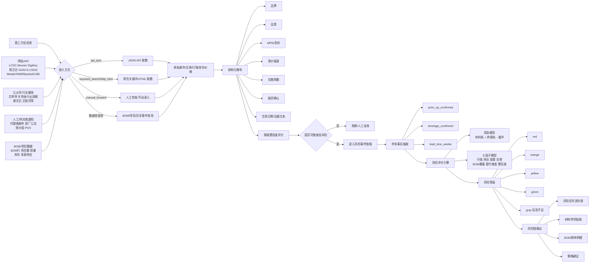
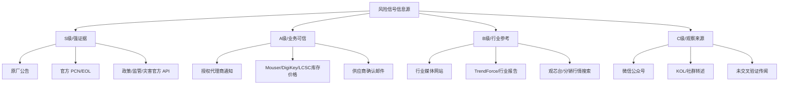
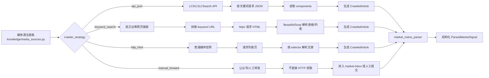
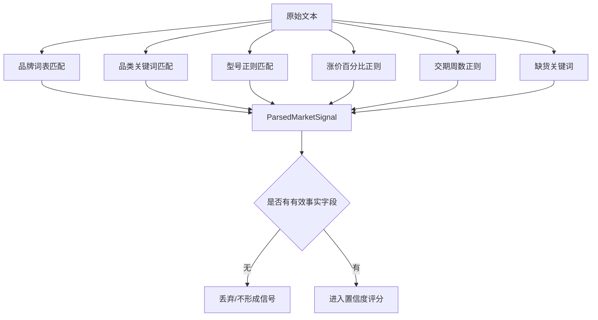
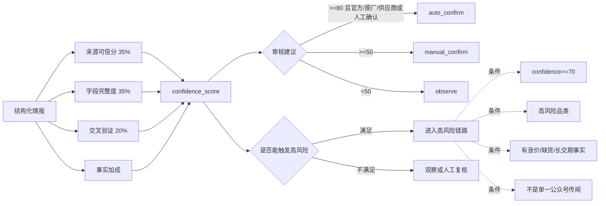
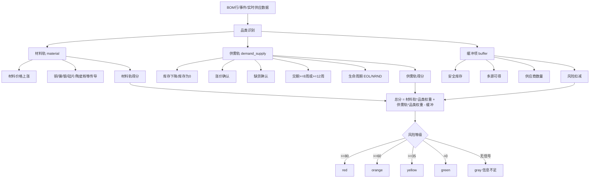
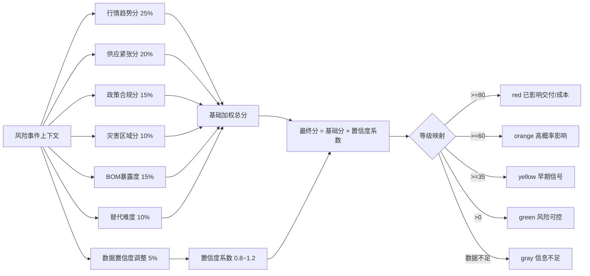
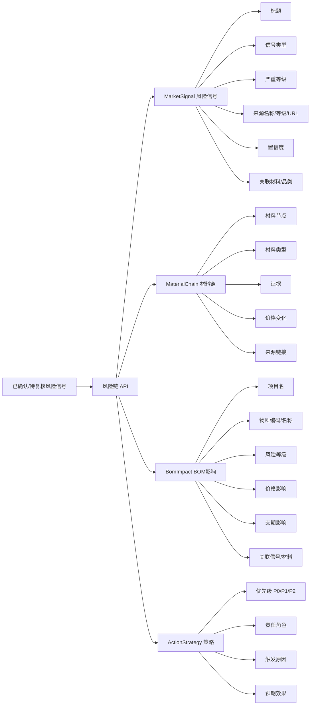

# 风险信号流：信息源渠道、取数逻辑与判断逻辑框图

> 适用范围：`交期风险排查V4`。本文聚焦系统最核心的“风险信号流”，说明它从哪些渠道取数、如何把外部信息归一化为风险信号、如何判断是否进入风险事件链路，以及如何传导到 BOM 影响和处置策略。

***

## 1. 一句话概括

风险信号流的核心逻辑是：

```text
外部信息源 → 采集/人工提交 → 结构化解析 → 置信度评分 → 市场事实抽取 → 材料/供需/政策/灾害/BOM 等因子评分 → 风险等级 → 材料链路/BOM影响/策略建议
```

系统不会把单一公众号传闻直接判为高风险；必须通过事实字段、来源可信度、交叉验证、库存/交期/价格/材料传导等证据共同形成风险判断。

***

## 2. 总体框图



***

## 3. 信息源渠道分层



系统代码中的来源可信度评分位于 `app/services/upstream/intelligence_scoring.py`：

| source\_type             | 来源含义            | 基础可信分 |
| ------------------------ | --------------- | ----: |
| `official`               | 官方/监管/灾害等权威来源   |    95 |
| `manufacturer`           | 原厂公告、原厂 PCN/EOL |    95 |
| `supplier_notice`        | 供应商/代理商通知       |    90 |
| `manual`                 | 人工确认录入          |    80 |
| `authorized_distributor` | 授权分销商           |    82 |
| `industry_media`         | 行业媒体            |    68 |
| `wechat`                 | 微信公众号           |    45 |
| `kol`                    | KOL/社群类消息       |    38 |
| `unknown`                | 未知来源            |    25 |

***

## 4. 取数逻辑框图



关键实现文件：

| 文件                                              | 作用                            |
| ----------------------------------------------- | ----------------------------- |
| `app/knowledge/media_sources.py`                | 登记可采集来源、接入方式、爬虫策略、基础置信度       |
| `app/services/media_crawler.py`                 | 根据策略执行 API/网页取数；公众号策略不伪造抓取    |
| `app/services/upstream/market_notice_parser.py` | 从标题/正文抽取品牌、品类、型号、涨价、交期、缺货等字段  |
| `app/services/upstream/manual_event_service.py` | 把人工/媒体事件归一化为 MarketEvent 入库字段 |
| `app/services/upstream/intelligence_scoring.py` | 对情报做来源、字段完整度、交叉验证评分           |

***

## 5. 结构化解析逻辑

市场通知解析器 `market_notice_parser.py` 主要把非结构化文本解析成以下字段：

```text
标题 + 正文 + 来源名
  → 品牌 brand
  → 品类 category
  → MPN mpn
  → 系列 series
  → 事件类型 event_type
  → 涨价幅度 increase_min_pct / increase_max_pct
  → 交期 lead_time_weeks
  → 是否缺货 shortage_confirmed
  → 生效日期 effective_date_text
  → 置信度 confidence
  → 证据片段 evidence_text
  → 审核状态 review_status
```

抽取规则示意：



典型关键词：

| 类型   | 示例                                               |
| ---- | ------------------------------------------------ |
| 缺货   | 缺货、紧缺、供需紧张、allocation、shortage、产能不足              |
| 涨价   | 涨价、价格上调、price increase、price adjustment、increase |
| 风险品类 | MLCC、DRAM、NAND、MCU、MOSFET、IGBT、PCB、连接器、晶振、继电器等   |
| 品牌   | 村田、三星电机、国巨、ST、NXP、Microchip、英飞凌、安森美、长晶、杨杰等       |

***

## 6. 情报置信度与高风险门控



高风险门控条件来自 `intelligence_scoring.py`：

```text
can_trigger_high_risk =
  confidence >= 70
  AND category in {high_cap_mlcc, mlcc, power_ic, mcu, pcb}
  AND 有事实确认字段
  AND 不是单一公众号传闻
```

事实确认字段包括：

- `increase_max_pct` 不为空。

- `shortage_confirmed = true`。

- `lead_time_weeks >= 12`。

单一公众号传闻的抑制逻辑：

```text
source_type == wechat
AND cross_validation_count == 0
AND 无品牌
AND 无 MPN
AND 无原始 URL
AND 无涨价幅度
→ 只能 observe，不能触发高风险。
```

***

## 7. 风险判断逻辑：双轨模型

双轨模型实现文件：`app/services/upstream/dual_track_risk_engine.py`



特殊规则：

| 规则                 | 说明                            |
| ------------------ | ----------------------------- |
| 生命周期 EOL           | 直接 `red`，分数 95                |
| 生命周期 NRND/OBSOLETE | 直接 `orange`，分数 80             |
| IC 类材料弱约束          | MCU/Power IC 不能仅凭硅片涨价直接红色预警   |
| 缓冲降分               | 安全库存、多源供应、供应商数量会降低最终风险分       |
| 信息不足               | 未发现材料或供需事实信号时输出 `gray`，不显示为正常 |

***

## 8. 风险判断逻辑：七因子模型

七因子模型实现文件：`app/services/upstream/multi_factor_risk_engine.py`



七因子说明：

| 因子      |  权重 | 主要依据                             |
| ------- | --: | -------------------------------- |
| 行情趋势分   | 25% | 材料价格 7/30/90 天变化率，材料信号权重         |
| 供应紧张分   | 20% | 库存下降、库存天数、缺货确认、交期周数、交期变化率        |
| 政策合规分   | 15% | BIS、USTR、实体清单、关税等政策信号；S 级来源可直接拉高 |
| 灾害区域分   | 10% | GDACS/USGS 灾害事件与供应商区域匹配          |
| BOM暴露度  | 15% | 用量占比、涉及项目数、是否关键物料                |
| 替代难度    | 10% | 替代料数量、认证周期、Pin 兼容度；无替代料为 100 分   |
| 数据置信度调整 |  5% | 来源级别、交叉验证数量，形成 0.8\~1.2 乘数       |

***

## 9. 风险事件链路输出框图



风险链 API 关键模型位于 `app/api/risk_chain.py`：

| 模型                   | 含义                          |
| -------------------- | --------------------------- |
| `MarketSignal`       | 风险信号流条目，包括来源、等级、置信度、关联材料/品类 |
| `MaterialChain`      | 材料链路，包括材料节点、证据和来源链接         |
| `BomImpact`          | BOM 受影响明细，包括项目、物料、价格/交期影响   |
| `ActionStrategy`     | 处置策略，包括优先级、责任角色和触发原因        |
| `RiskChainDashboard` | 前端风险链驾驶舱整体返回结构              |

***

## 10. 前端展示逻辑

前端风险信号流组件：`frontend/src/components/RiskSignalFlow.vue`

展示字段：

- 风险等级：`signal.level`

- 类型：行情、政策、灾害、库存、PCN

- 标题：`signal.title`

- 品类：`signal.category`

- 时间：`signal.timestamp`

- 描述：`signal.description`

- 影响品牌：`signal.affected_brands`

- 传导链路：`signal.impact_chain`

前端类型过滤：

```text
market   行情
policy   政策
disaster 灾害
inventory 库存
pcn      PCN
```

刷新逻辑：

- 组件内部 5 分钟倒计时。

- 倒计时结束触发 `refresh` 事件。

- 父页面重新请求风险链数据。

***

## 11. 核心维护结论

1. 风险信号流不是单一爬虫功能，而是“信息源 → 结构化 → 置信度 → 风险评分 → BOM影响”的完整链路。
2. 公众号类来源当前是 `manual_forward`，不直接 HTTP 抓取，也不应宣传为自动抓取。
3. 单一公众号、缺少品牌/型号/原始 URL/交叉验证/事实字段时，只能进入观察，不应直接触发高风险。
4. 官方、原厂、供应商通知、授权分销商和灾害官方 API 的权重明显高于媒体和公众号。
5. 风险等级必须区分“无风险”和“信息不足”；信息不足应输出 `gray`。
6. BOM 影响不是只看事件严重度，还要叠加 BOM 用量、项目数、关键物料、替代难度和库存/交期。
7. 对 IC 类物料，系统已有“材料传导弱约束”：不能仅凭硅片涨价就直接红色预警。
8. 当前文档反映的是 V4 代码现状，后续如启用新的 API Key 或新增自动采集源，应同步更新 `media_sources.py` 和本说明。

